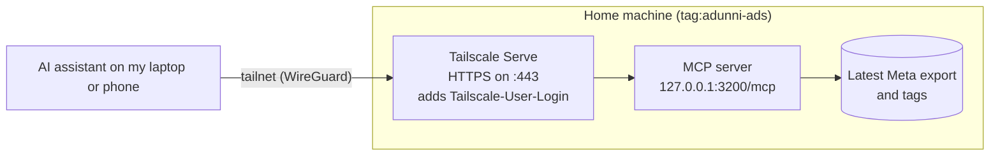

# Adunni Ad Insights

Turns a Meta Ads export into a clear call for every ad (keep, pause, watch or wait) and compares creative types, with honest error bars. It also runs as a private MCP server, so an AI assistant on my phone or laptop can answer "which ads should I pause today?" without my ad data ever being on the public internet.

## Why I built it

I run [By Adunni](https://byadunni.com), a handmade beaded bag brand, and I manage its Meta ads myself on a small daily budget. The hardest part isn't making ads; it's deciding which to keep. I was making those calls late at night, on a hunch, from a dashboard of numbers.

Two things kept going wrong:

- **I kept losing ads too slowly.** An ad with £40 spent and no add-to-carts was obviously not working, but without a rule I'd give it "one more day".
- **I trusted tiny numbers too much.** One purchase from a new ad felt like a winner. With 50 clicks, it could easily be luck.

This tool turns my rules into code and shows how sure each number is.

## What it tells you

Running it on the included sample export (made-up numbers shaped like a small shop's):

```text
Ad calls (target £30.00 per purchase)

PAUSE  Unboxing – trend audio  [trend-audio]
       £62.00 spent, over twice your £30.00 target, with no purchases.
PAUSE  Beading process – studio  [behind-the-scenes]
       £41.75 spent with no add-to-carts. People aren't getting as far as the bag.
KEEP   Coffee bag – product close-up  [product-forward]
       £21.40 per purchase, within your £30.00 target.
KEEP   GRWM – wedding guest  [styling, trend-audio]
       £29.10 per purchase, within your £30.00 target. Based on only 1 purchase, so promising, not proven.
WATCH  Moon bag, on-body styling  [product-forward, styling]
       £38.50 per purchase, above your £30.00 target.
WAIT   Packing orders – behind the scenes  [behind-the-scenes]
       2 add-to-carts but no purchase yet. Judge again at £60.00 spent.
WAIT   Restock teaser – new colours  [product-forward]
       Only £7.40 spent. Too early to judge; look again at £10.00.

Creative types (cheapest cost per purchase first)

Type               Ads  Spend    Purchases  Cost/purchase  ROAS   Purchases per 100 clicks (95% range)
-----------------  ---  -------  ---------  -------------  -----  ------------------------------------
product-forward    3    £110.10  4          £27.53         5.00x  1.1% (0.4–2.9%)
styling            2    £67.60   2          £33.80         4.07x  0.9% (0.3–3.3%)
trend-audio        2    £91.10   1          £91.10         1.43x  0.4% (0.1–2%)
behind-the-scenes  2    £57.05   0          –              0.00x  0% (0–1.2%)

Every type's range overlaps the best one's, so the differences could still be chance. Keep testing before cutting a whole type.
```

That last line is the point of the tool. Product-forward looks best, but at this volume the ranges overlap, so the honest answer is "promising, keep testing", not "stop making behind-the-scenes videos".

## The rules

Each ad gets one call, checked in this order. All the numbers can be changed (see `.env.example`).

| Call | When | Why |
| --- | --- | --- |
| wait | Spend is under £10 | Too little data to say anything |
| pause | £20 spent and no add-to-carts | People see it, but nobody gets as far as the bag |
| pause | Twice the target spent (£60) and no purchases | It's had a fair chance to sell once |
| keep | Cost per purchase at or under the £30 target | Paying its way. Under 3 purchases, it's flagged as promising, not proven |
| watch | Purchases, but above target | Selling, but too expensively |
| wait | Anything else | Some interest, not enough spend yet |

### How sure are the numbers?

"Purchases per 100 clicks" comes with a 95% range, using the [Wilson score interval](https://en.wikipedia.org/wiki/Binomial_proportion_confidence_interval#Wilson_score_interval). It's the standard choice for small counts: one purchase from 10 clicks is "10%", but the range is roughly 2% to 40%, which is the truth about how little 10 clicks can tell you.

When comparing creative types, a type is only called "clearly behind" if its range doesn't overlap the best type's at all. That's a deliberately cautious test. Overlapping ranges don't prove two types are the same; they mean you can't yet tell them apart.

### What it can't do

- **Attribution is Meta's.** Purchases and revenue are what Meta reports, which includes some view-through conversions and can differ from Shopify. Matching against Shopify orders is on the list below.
- **It judges ads you've already run.** It can't predict how a new creative will do; it tells you sooner and more consistently which ones to stop.
- **Small budgets mean wide ranges.** At a few pounds a day, it will spot clear losers much sooner than it can prove a winner.

## Use it with your own ads

Needs Node 18 or newer.

```bash
npm install
npm run report                                   # the sample data
npm run report -- path/to/export.csv my-tags.json
npm run report -- path/to/export.csv my-tags.json --json
```

1. In Ads Manager, export a report at ad level with these columns: Ad name, Amount spent, Impressions, Link clicks, Adds to cart, Purchases and Purchases conversion value. A day-by-day export works too; rows for the same ad are added together.
2. Copy `data/tags.example.json` to `data/tags.json` and tag each ad by its exact name, for example `["product-forward"]` or `["behind-the-scenes", "trend-audio"]`. An ad can have several tags.
3. Run the report.

Column names vary with your settings and language. If one can't be found, the error lists every column it did find, so you can see what to rename. Real exports and your tags file are git-ignored.

## Private AI access over Tailscale

The same analysis is available as an [MCP](https://modelcontextprotocol.io) server with three read-only tools:

| Tool | What it answers |
| --- | --- |
| `ad_calls` | "Which ads should I pause today?" (optionally filtered to one call) |
| `compare_creative_types` | "Are product-forward videos actually doing better?" |
| `ad_details` | "How is the Coffee bag ad doing?" |

Ad spend and revenue are private business data, so the server isn't on the public internet. It's shared over my [Tailscale](https://tailscale.com) tailnet:



To set it up:

1. Install Tailscale on the machine holding your exports, and on the device running your AI assistant.
2. Copy `.env.example` to `.env`, set `OWNER_LOGINS` to your Tailscale login and point `ADS_CSV` and `TAGS_FILE` at your files.
3. Start the server. On Node 20.6 or newer, `npx tsx --env-file=.env src/http.ts` reads the `.env` file for you. On older versions, set the variables in your shell and run `npm run mcp`.
4. Share it on your tailnet:

   ```bash
   tailscale serve --bg 3200
   ```

5. Add the policy in [`tailscale/policy.example.hujson`](tailscale/policy.example.hujson), and tag the machine `tag:adunni-ads`.
6. In an MCP client on a tailnet device, add a remote server at `https://<machine-name>.<your-tailnet>.ts.net/mcp`.

The client must run on a device in your tailnet. A connector that calls from a provider's cloud servers can't reach it, which is the point.

Check Tailscale's docs for [Serve](https://tailscale.com/kb/1312/serve) and [grants](https://tailscale.com/kb/1324/grants), and your MCP client's docs, before relying on these steps.

### Security notes

- **Listens on `127.0.0.1` only.** The `Tailscale-User-Login` header is only trustworthy because Tailscale Serve, on the same machine, is the only way in.
- **Two layers.** The tailnet policy lets only owners reach the machine. The server then checks the login again against `OWNER_LOGINS`, so a policy mistake alone doesn't expose the data.
- **Read-only.** No tool can change the ad account; the server only reads exported files.
- **Stateless.** Each request gets a fresh MCP server, so requests can't interfere with each other.
- **Not for Tailscale Funnel.** Funnel would make it public, and public callers have no tailnet identity, so they'd all be refused.

## Tests

```bash
npm test          # 35 tests
npm run typecheck
```

- **Import:** CSV quoting, line endings, blank cells, adding up repeated rows, flexible column names and a helpful missing-column error.
- **Analysis:** every rule and its boundary, divide-by-zero cases, sorting, ads with two tags, and the overlap check.
- **Statistics:** the Wilson range checked against known values, including 0 purchases.
- **MCP server:** 401 and 403 access checks, plus every tool called through a real MCP client over HTTP, including a broken export.

## Project layout

```
src/
  cli.ts          the text report
  http.ts         MCP over HTTP, on 127.0.0.1, owners only
  mcp.ts          the three MCP tools
  analysis.ts     metrics, calls and creative-type comparison
  stats.ts        Wilson range
  import-meta.ts  reads Meta Ads exports and tags
  csv.ts          CSV parser
  config.ts       rules and file loading
data/             sample export and example tags (made-up numbers)
tailscale/        example tailnet policy
test/             Vitest tests
```

## What I'd add next

- Match purchases to Shopify orders using UTM parameters, so the numbers don't depend only on Meta's attribution.
- Pull data straight from the Meta Marketing API, so there's no export step.
- Track how each call changes week to week, to see whether the rules are too strict or too loose.

## Licence

MIT
